# UCI Online Retail — Exploratory Data Analysis and Business Insights

## Project Overview

This project explores online retail transactions to understand revenue trends, product performance, country-wise sales, customer purchasing patterns, and unusual transactions using Python.

The goal was to transform raw transaction data into meaningful insights that can help a business understand its sales performance and make better-informed decisions.

## Business Problem

An online retailer generates a large volume of transactions, making it difficult to identify important patterns by examining raw data alone. The business needs to understand its top-performing products, key markets, monthly revenue trends, customer contributions, and unusual transactions.

This project uses Exploratory Data Analysis (EDA) to investigate these areas and communicate findings through visualizations.

## Project Objectives

- Inspect and clean the dataset.
- Identify missing values and duplicate records.
- Analyze revenue by country, product, month, and customer.
- Explore relationships between quantity, unit price, and revenue.
- Investigate cancellations, negative values, and potential outliers.
- Create visualizations to communicate findings.
- Develop practical business recommendations from the analysis.

## Dataset and Source

- **Source:** [UCI Machine Learning Repository — Online Retail](https://archive.ics.uci.edu/dataset/352/online+retail)
- **Original records:** 541,909 rows and 8 columns
- **Period:** December 2010 – December 2011
- **Important limitation:** December 2011 contains data only through December 9.
- **Key columns:** InvoiceNo, StockCode, Description, Quantity, InvoiceDate, UnitPrice, CustomerID, Country.

## Tools and Technologies

- **Python** — Data analysis
- **Pandas** — Data cleaning, grouping, and summarization
- **NumPy** — Numerical operations
- **Matplotlib** — Visualization customization
- **Seaborn** — Statistical visualizations
- **Jupyter Notebook** — Analysis and documentation

## Data Cleaning and Preparation

- Removed 5,268 duplicate rows, leaving 536,641 records.
- Examined missing CustomerID and product descriptions.
- Created a `Revenue` column using `Quantity × UnitPrice`.
- Investigated negative quantities, negative prices, zero values, and potential outliers.
- Examined cancelled transactions and unusual records rather than automatically removing all of them.

## Exploratory Data Analysis and Visualizations

### 1. Revenue Analysis

#### Revenue Distribution

Examined the distribution of revenue across transactions to understand its spread and identify unusually large or negative values.

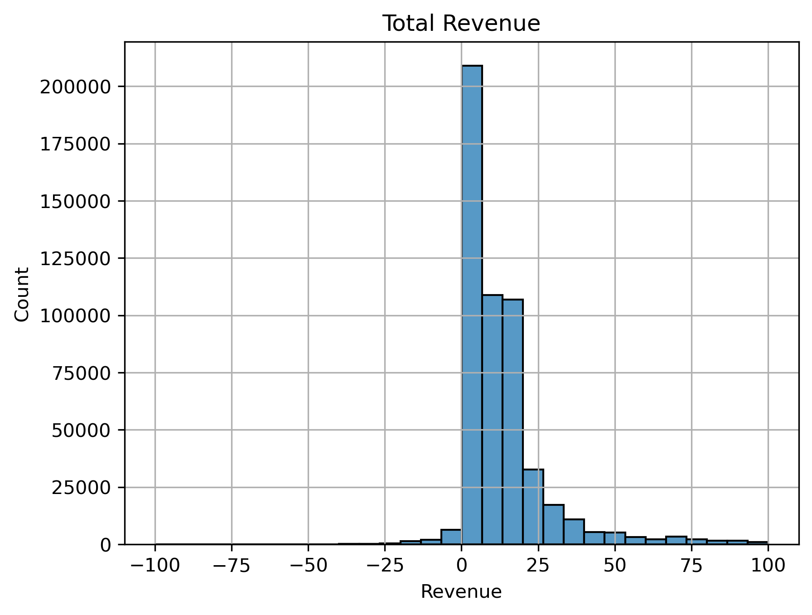

#### Positive Revenue Distribution

Focused on transactions with positive revenue to examine sales values without negative transactions dominating the distribution.

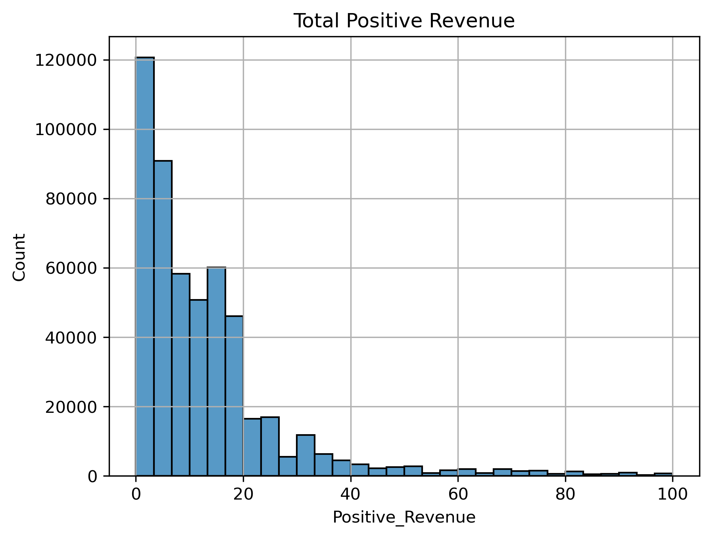

#### Monthly Revenue Trends

Analyzed revenue across months to explore changes in sales activity over the available period.

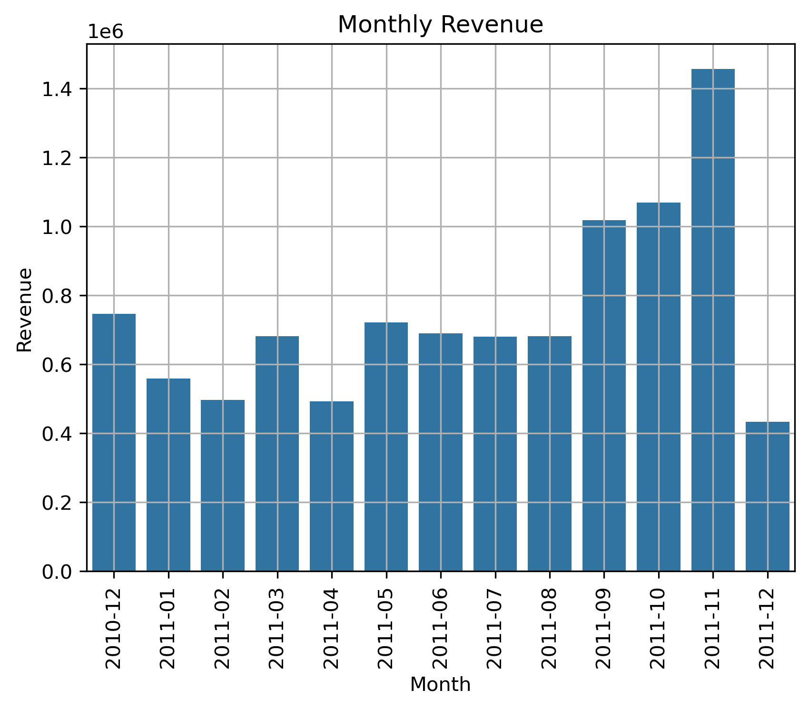

### 2. Product and Customer Analysis

#### Product Revenue

Compared revenue across products to identify products contributing the most revenue.

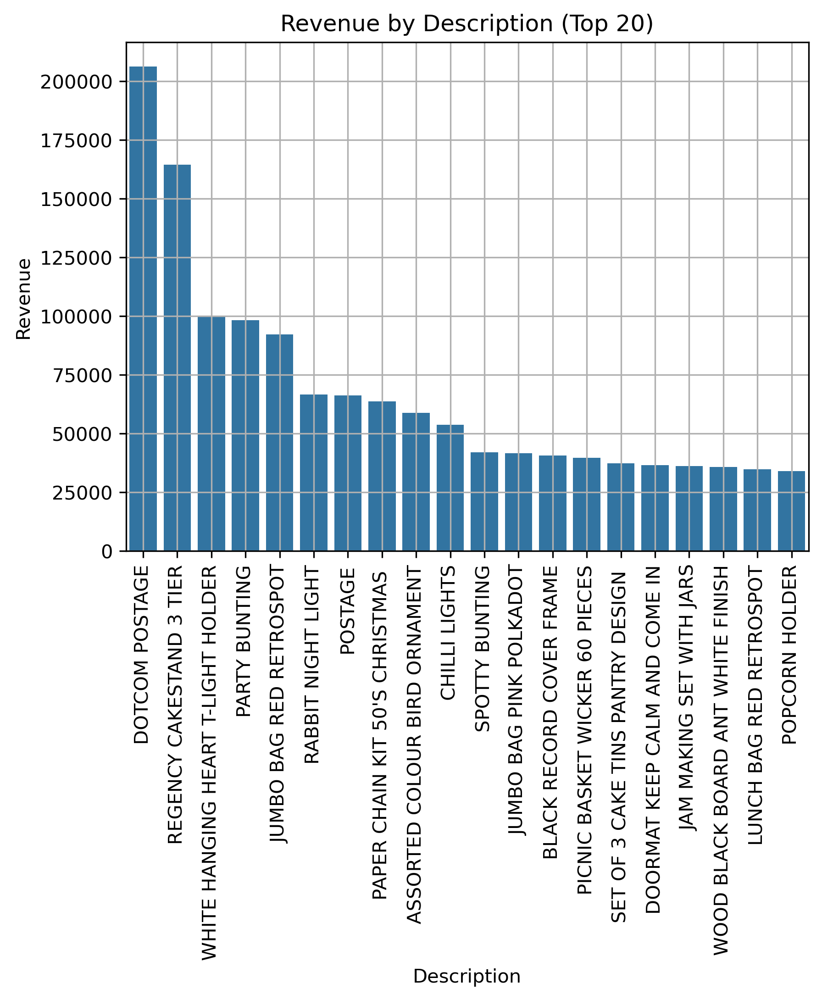

#### Top 10 Customers by Revenue

Identified the customers with the highest recorded revenue to understand their contribution to sales.

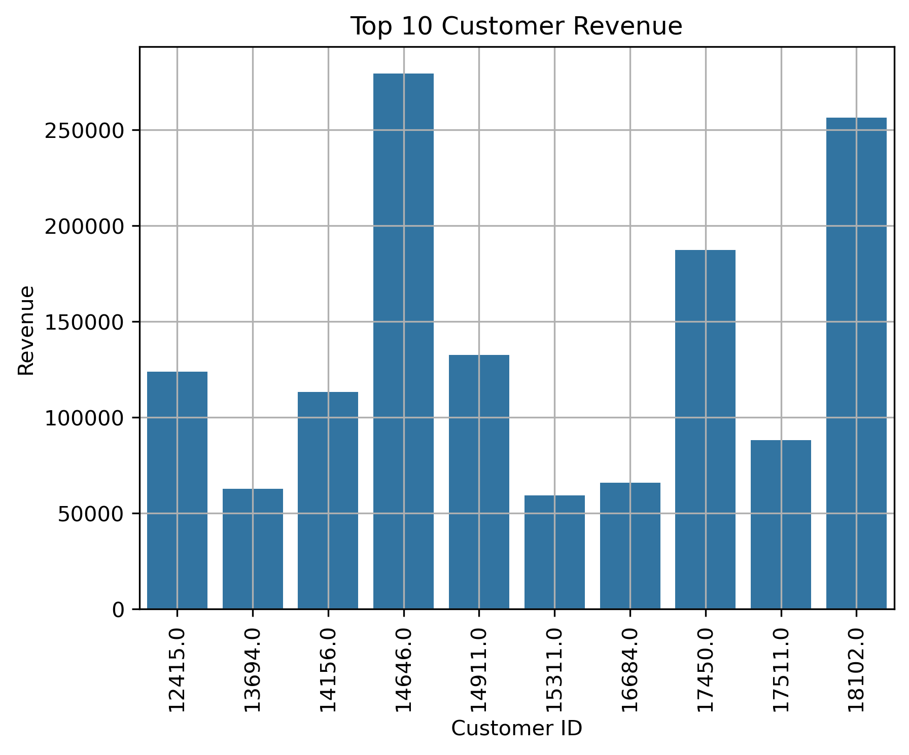

### 3. Country Analysis

#### Country vs Revenue

Compared revenue across countries to identify the retailer's strongest markets.

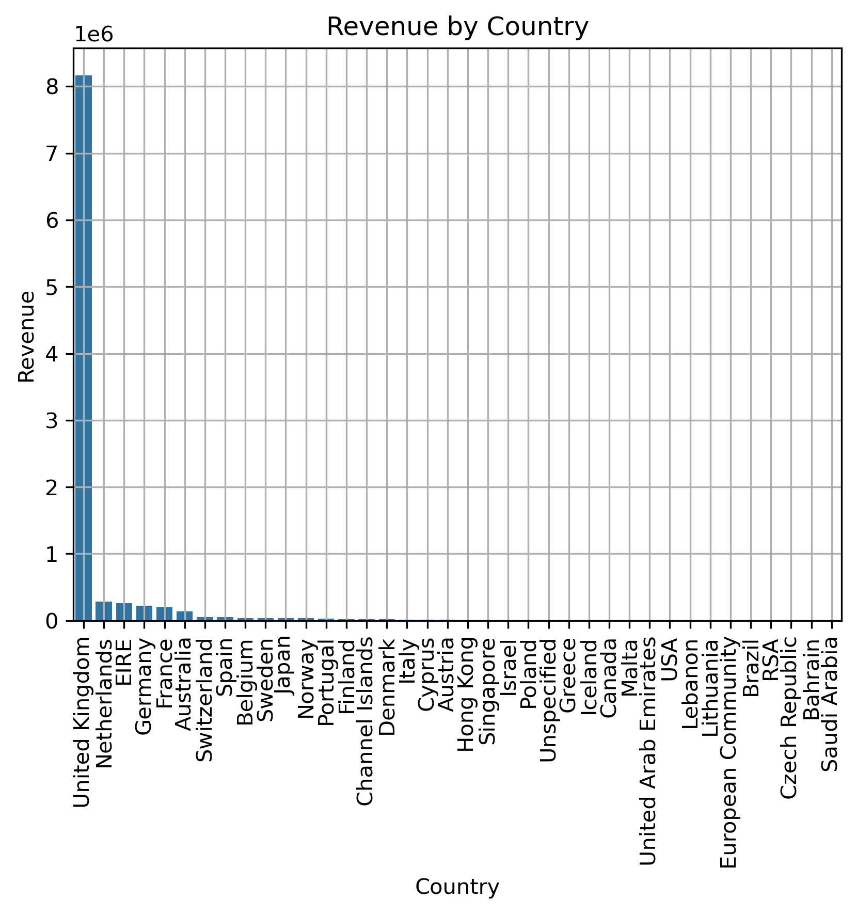

#### Top Countries by Transaction Count

Compared transaction counts across countries to understand where the retailer recorded the most transactions.

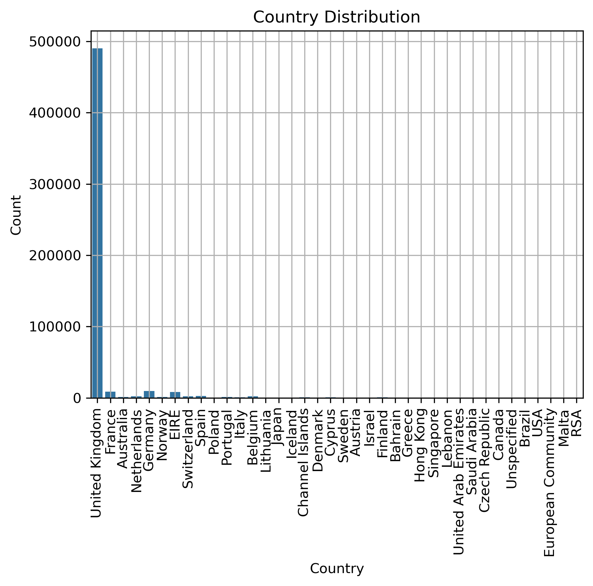

### 4. Quantity and Price Analysis

#### Quantity Distribution

Examined the distribution of quantities per transaction to understand common order quantities and unusually large values.

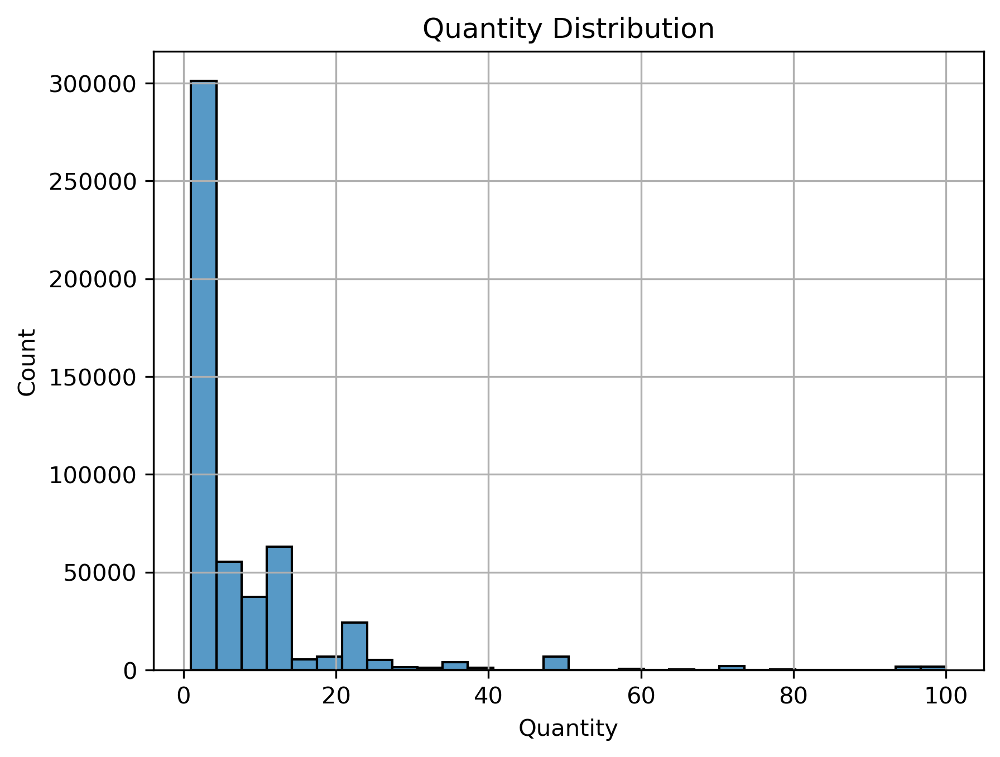

#### Unit Price Distribution

Explored unit prices to understand the range of prices recorded in the dataset.

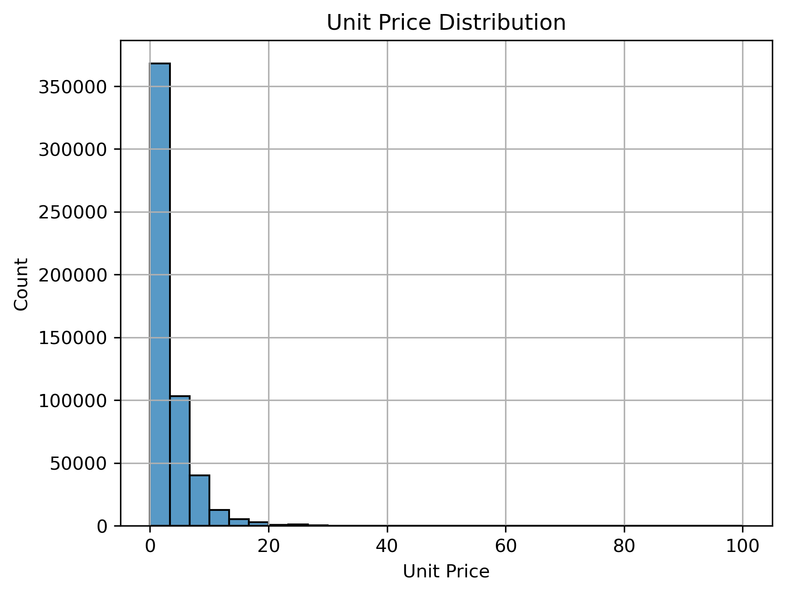

#### Quantity by Price

Explored the relationship between the quantity purchased and the unit price.

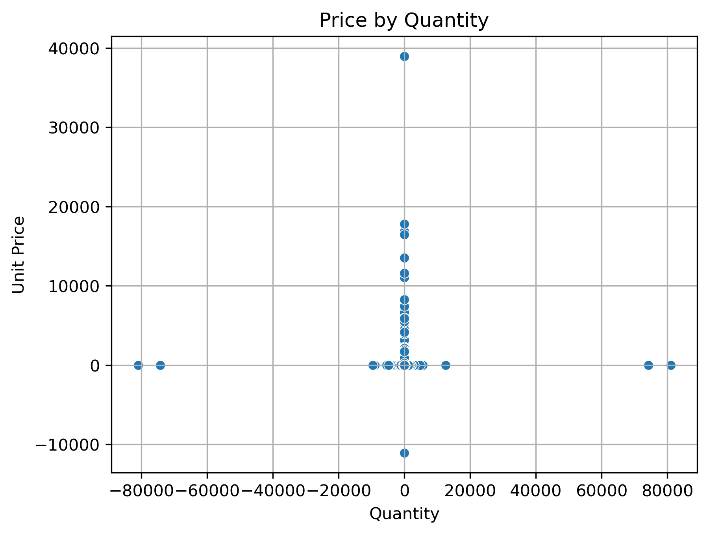

### 5. Outlier Analysis

#### Unit Price Outliers

Used the Interquartile Range (IQR) method to flag potential outliers in unit prices. These records require investigation before deciding whether they represent errors or valid transactions.

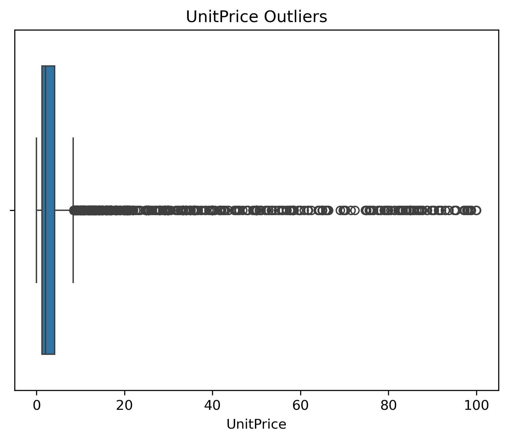

#### Quantity Outliers

Used the IQR method to identify unusually low or high quantities that may require further investigation.

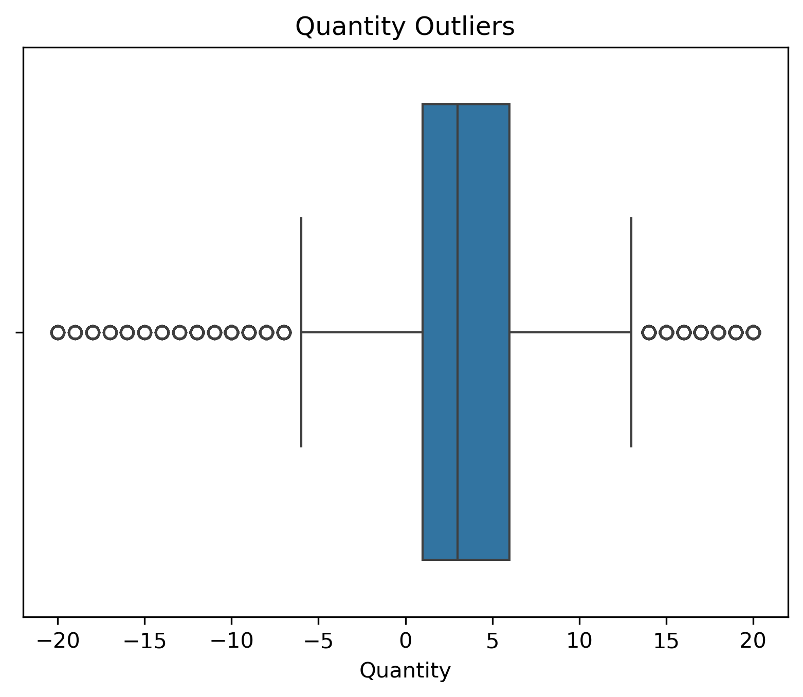

## Key Findings

- The United Kingdom was the largest market by revenue in the analyzed dataset.
- Revenue varied across products, countries, customers, and months.
- Some transactions contained negative quantities or negative revenue, requiring consideration of cancellations and returns.
- Missing customer IDs limited the ability to analyze customer-level purchasing behavior comprehensively.
- The IQR method flagged potential outliers in quantity and unit price. These values were investigated rather than automatically treated as errors.

## Business Insights and Recommendations

- **Product planning:** Use product-level revenue analysis to identify high-performing products and review their stock availability.
- **Market performance:** Compare revenue and transaction counts by country to understand both sales contribution and transaction activity.
- **Customer analysis:** Use top-customer revenue results to understand revenue concentration, while considering missing customer IDs.
- **Sales planning:** Monitor monthly revenue trends and account for the incomplete final month when comparing periods.
- **Data quality:** Investigate cancellations, negative values, missing information, and outliers before making decisions based on the data.

## Limitations

- The dataset ends on December 9, 2011, so December 2011 is incomplete.
- Revenue is calculated as `Quantity × UnitPrice`; it should not be interpreted as profit because product cost information is unavailable.
- Missing customer IDs limit customer-level analysis.
- Potential outliers are not necessarily data errors and require context before removal.

## Conclusion

This project demonstrates how Python can be used to clean, explore, and visualize retail transaction data. Through revenue analysis, product and country comparisons, customer analysis, and outlier investigation, the project identifies patterns that can support better-informed sales and inventory decisions.

## Skills Demonstrated

Python · Pandas · NumPy · Data Cleaning · Exploratory Data Analysis · Data Visualization · Outlier Detection · Business Insights
